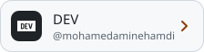
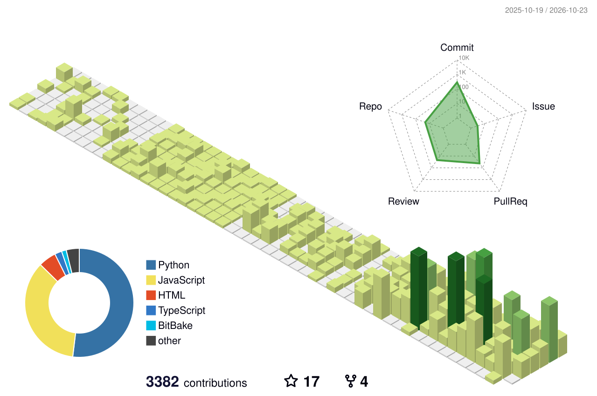
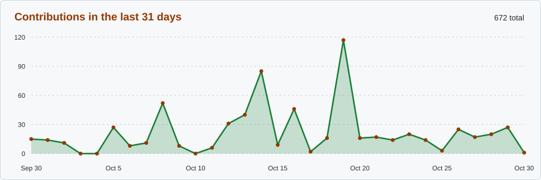

<a href="https://github.com/mohamedaminehamdi">
  <picture>
    <source media="(prefers-color-scheme: dark)" srcset="https://raw.githubusercontent.com/mohamedaminehamdi/mohamedaminehamdi/main/dark_mode.svg">
    
  </picture>
</a>

  <a href="https://www.linkedin.com/in/mohamed-amine-hamdi/"><picture><source media="(prefers-color-scheme: dark)" srcset="assets/buttons/linkedin-dark.svg"></picture></a>
  <a href="https://medium.com/@mohamedaminehamdi"><picture><source media="(prefers-color-scheme: dark)" srcset="assets/buttons/medium-dark.svg"></picture></a>
  <a href="https://dev.to/mohamedaminehamdi"><picture><source media="(prefers-color-scheme: dark)" srcset="assets/buttons/dev-dark.svg"></picture></a>
  <a href="https://x.com/aminehamdibarca"><picture><source media="(prefers-color-scheme: dark)" srcset="assets/buttons/x-dark.svg"></picture></a>

  <picture><source media="(prefers-color-scheme: dark)" srcset="https://streak-stats.demolab.com/?user=mohamedaminehamdi&background=161b22&border=30363d&stroke=30363d&ring=ffa657&fire=ffa657&currStreakNum=c9d1d9&sideNums=c9d1d9&currStreakLabel=ffa657&sideLabels=c9d1d9&dates=8b949e"></picture>

  <picture>
    <source media="(prefers-color-scheme: dark)" srcset="https://raw.githubusercontent.com/mohamedaminehamdi/mohamedaminehamdi/output/github-snake-dark.svg">
    
  </picture>

## Stack

  <a href="https://mohamedaminehamdi.github.io/mohamedaminehamdi/"><picture>
    <source media="(prefers-color-scheme: dark)" srcset="assets/stack-sphere-dark.svg">
    
  </picture></a>
   Click the sphere for the interactive version: hover a logo to enlarge it, drag to spin.

## GitHub activity

<picture><source media="(prefers-color-scheme: dark)" srcset="profile-3d-contrib/profile-night-rainbow-animate.svg"></picture>

  <picture><source media="(prefers-color-scheme: dark)" srcset="https://github-readme-stats.vercel.app/api?username=mohamedaminehamdi&show_icons=true&count_private=true&rank_icon=github&bg_color=161b22&title_color=ffa657&text_color=c9d1d9&icon_color=3fb950&border_color=30363d&ring_color=ffa657"></picture>
  <picture><source media="(prefers-color-scheme: dark)" srcset="https://github-readme-stats.vercel.app/api/top-langs/?username=mohamedaminehamdi&layout=compact&langs_count=8&bg_color=161b22&title_color=ffa657&text_color=c9d1d9&border_color=30363d"></picture>

<picture><source media="(prefers-color-scheme: dark)" srcset="assets/activity-dark.svg"></picture>

  <picture><source media="(prefers-color-scheme: dark)" srcset="assets/trophies-dark.svg"></picture>

