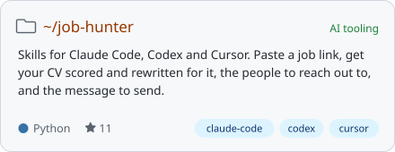
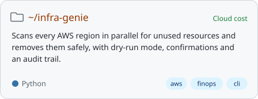
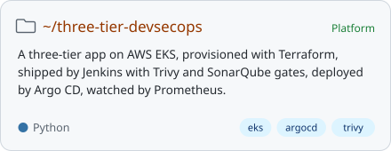
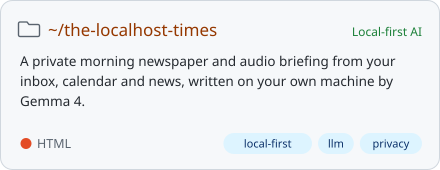
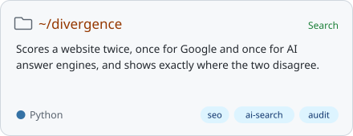
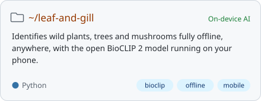
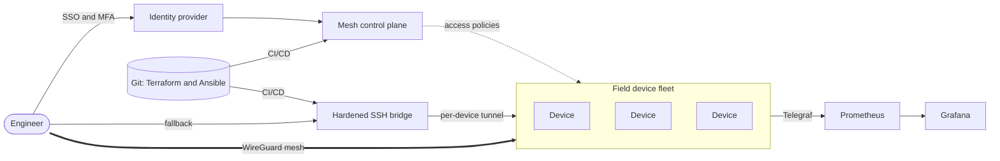

<a href="https://github.com/mohamedaminehamdi">
  <picture>
    <source media="(prefers-color-scheme: dark)" srcset="https://raw.githubusercontent.com/mohamedaminehamdi/mohamedaminehamdi/main/dark_mode.svg">
    
  </picture>
</a>

  <a href="https://www.linkedin.com/in/mohamed-amine-hamdi/"><picture><source media="(prefers-color-scheme: dark)" srcset="assets/buttons/linkedin-dark.svg"></picture></a>
  <a href="https://medium.com/@mohamedaminehamdi"><picture><source media="(prefers-color-scheme: dark)" srcset="assets/buttons/medium-dark.svg"></picture></a>
  <a href="https://dev.to/mohamedaminehamdi"><picture><source media="(prefers-color-scheme: dark)" srcset="assets/buttons/dev-dark.svg"></picture></a>
  <a href="https://x.com/aminehamdibarca"><picture><source media="(prefers-color-scheme: dark)" srcset="assets/buttons/x-dark.svg"></picture></a>

I keep fleets of embedded devices reachable, patched and trusted, and I automate the platform around them. By day that means secure remote access, WireGuard mesh networking and Kubernetes at [EcoG](https://www.ecog.io) in Munich. On the side I build local-first AI tools and write about what I learn along the way.

## Featured work

  <a href="https://github.com/mohamedaminehamdi/job-hunter"><picture><source media="(prefers-color-scheme: dark)" srcset="assets/projects/job-hunter-dark.svg"></picture></a>
  <a href="https://github.com/mohamedaminehamdi/infra-genie"><picture><source media="(prefers-color-scheme: dark)" srcset="assets/projects/infra-genie-dark.svg"></picture></a>

  <a href="https://github.com/mohamedaminehamdi/three-tier-devsecops-project"><picture><source media="(prefers-color-scheme: dark)" srcset="assets/projects/three-tier-devsecops-project-dark.svg"></picture></a>
  <a href="https://github.com/mohamedaminehamdi/the-localhost-times"><picture><source media="(prefers-color-scheme: dark)" srcset="assets/projects/the-localhost-times-dark.svg"></picture></a>

  <a href="https://github.com/mohamedaminehamdi/divergence"><picture><source media="(prefers-color-scheme: dark)" srcset="assets/projects/divergence-dark.svg"></picture></a>
  <a href="https://github.com/mohamedaminehamdi/leaf-and-gill"><picture><source media="(prefers-color-scheme: dark)" srcset="assets/projects/leaf-and-gill-dark.svg"></picture></a>

## Latest on Medium

<!-- MEDIUM:START -->
<a href="https://medium.com/@mohamedaminehamdi">Read my articles on Medium</a>
<!-- MEDIUM:END -->

## Experience

- **DevSecOps Engineer, EcoG** (now): secure remote access, WireGuard mesh networking and fleet management for embedded devices
- **DevSecOps Engineer, Decentral AI**
- **CTO, Colocqui**
- **President, INSAT Junior Enterprise**

ICT Engineering, INSAT. Cisco CCNA. Speaker at AWS Community Day DACH.

<b>A pattern I build: secure access to devices in the field</b>

 

Every device stays reachable without ever being exposed to the internet. Engineers authenticate once, policies decide which device they can reach, and a hardened fallback path exists for when the mesh is down.

## Stack

  <a href="https://mohamedaminehamdi.github.io/mohamedaminehamdi/"><picture>
    <source media="(prefers-color-scheme: dark)" srcset="assets/stack-sphere-dark.svg">
    
  </picture></a>
   Click the sphere for the interactive version: hover a logo to enlarge it, drag to spin.

## GitHub activity

<picture><source media="(prefers-color-scheme: dark)" srcset="profile-3d-contrib/profile-night-rainbow-animate.svg"></picture>

  <picture><source media="(prefers-color-scheme: dark)" srcset="https://github-readme-stats.vercel.app/api?username=mohamedaminehamdi&show_icons=true&include_all_commits=true&count_private=true&rank_icon=github&bg_color=161b22&title_color=ffa657&text_color=c9d1d9&icon_color=3fb950&border_color=30363d&ring_color=ffa657"></picture>
  <picture><source media="(prefers-color-scheme: dark)" srcset="https://github-readme-stats.vercel.app/api/top-langs/?username=mohamedaminehamdi&layout=compact&langs_count=8&bg_color=161b22&title_color=ffa657&text_color=c9d1d9&border_color=30363d"></picture>

  <picture><source media="(prefers-color-scheme: dark)" srcset="https://streak-stats.demolab.com/?user=mohamedaminehamdi&background=161b22&border=30363d&stroke=30363d&ring=ffa657&fire=ffa657&currStreakNum=c9d1d9&sideNums=c9d1d9&currStreakLabel=ffa657&sideLabels=c9d1d9&dates=8b949e"></picture>

<picture><source media="(prefers-color-scheme: dark)" srcset="https://github-readme-activity-graph.vercel.app/graph?username=mohamedaminehamdi&bg_color=161b22&color=c9d1d9&title_color=ffa657&line=3fb950&point=ffa657&area=true&area_color=3fb950&hide_border=false&border_color=30363d&radius=6&custom_title=Contributions%20in%20the%20last%2031%20days"></picture>

  <picture><source media="(prefers-color-scheme: dark)" srcset="https://github-profile-trophy.vercel.app/?username=mohamedaminehamdi&theme=darkhub&no-frame=true&no-bg=true&margin-w=8&column=7"></picture>

<picture>
  <source media="(prefers-color-scheme: dark)" srcset="https://raw.githubusercontent.com/mohamedaminehamdi/mohamedaminehamdi/output/github-snake-dark.svg">
  
</picture>
